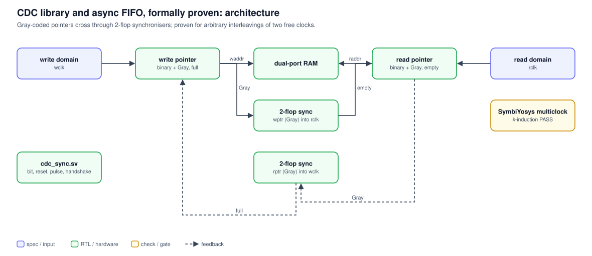
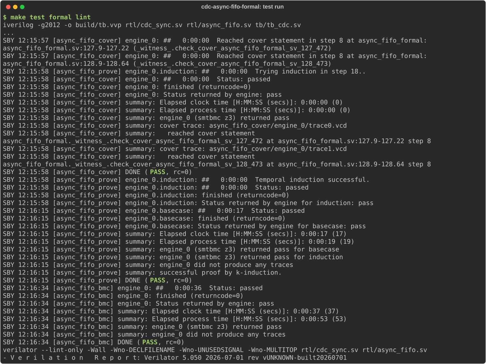

# Clock-domain crossing: async FIFO + CDC primitives, formally proven

[](https://github.com/Ana2601/cdc-async-fifo-formal/actions/workflows/ci.yml)

A CDC library of the kind every SoC and FPGA design uses, with a dual-clock FIFO proven correct for arbitrary clock interleavings.



## Contents

| Module | Purpose |
|---|---|
| `async_fifo` | dual-clock FIFO (Cummings style): binary pointers for addressing, **Gray-coded** pointers crossed through 2-flop synchronisers, conservative full/empty, fill levels on both sides |
| `cdc_sync_bit` | N-flop level synchroniser (`ASYNC_REG` attributes for Vivado placement/STA) |
| `cdc_reset_sync` | asynchronous assert, synchronous de-assert reset bridge |
| `cdc_pulse_sync` | single-cycle pulse across domains (toggle + edge detect) |
| `cdc_handshake` | multi-bit bus crossing with a 4-phase req/ack handshake (data held stable, so no per-bit synchronisers) |

## Formal verification (`formal/`, SymbiYosys multiclock)

`wclk` and `rclk` are free inputs: the solver chooses every edge, so all phase relationships are covered, with ratios up to 3:1 either way (fairness assumption). Properties:

- no overflow or underflow: true occupancy always within 0…DEPTH
- full and empty are **never optimistic**
- Gray pointers change by at most one bit per update (safe to synchronise)
- **data integrity**: an arbitrarily chosen write (`anyconst` pointer) is read back intact and in order
- the synchronised pointers are always older copies of the real ones (ordering invariants)

| Task | Result |
|---|---|
| `prove` (k-induction, depth 20) | **PASS**: unbounded proof |
| `bmc` (24 steps) | PASS |
| `cover` | "FIFO full" and "watched word read back while full" reached |

During development, a BMC counterexample turned out to be a bug in the **harness**, not the FIFO: pointer differences evaluated at 32 bits (0 − 4 became huge instead of 4 mod 8). Fixing it with a width-correct `dist()` also closed the induction.

## Simulation (`tb/tb_cdc.sv`)

Eight clock-ratio corners with random start phases: equal, 1.04×, 1.30×, 1.56×, π×, 1/π×, 7× and 1/7×. Bursty traffic drives the FIFO between full and empty; it also exercises the pulse and handshake synchronisers.

| Check (every ratio) | Result |
|---|---|
| FIFO words, in order and intact | 20,000 / 20,000 |
| Pulses delivered | 500 / 500 |
| Handshake words | 300 / 300 |
| Errors | **0** |

## Run

```bash
make test     # 8 clock-ratio corners
make formal   # bmc + prove + cover
make lint
```

## Test run

Output of the CI command (`make test formal lint`), captured from a local run:



## Limitations

The formal model has no metastability injection (synchronisers are modelled as ideal flops), and the fairness assumption bounds the proven ratio to 3:1; simulation covers 7:1. The FIFO depth must be a power of two.

## Setup

- [OSS CAD Suite](https://github.com/YosysHQ/oss-cad-suite-build) (Icarus Verilog, Verilator, Yosys, SymbiYosys)
- z3 (`brew install z3` / `apt install z3`)

```bash
make test
make formal
make lint
```

The same commands run in CI on every push (`.github/workflows/ci.yml`).
